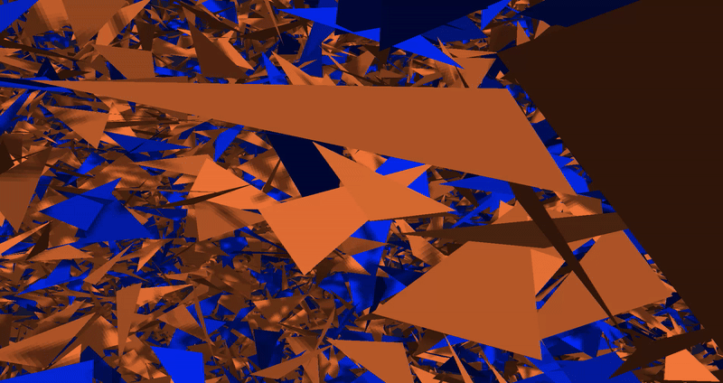

# Triangles

A C++ application for exploring triangle intersections in 3D. Choose how many
triangles to generate, then fly through the scene using mouse and keyboard
controls. Colors distinguish intersecting triangles from the rest of the scene.

## Preview

  

## Features

- Generate a chosen number of triangles with random positions and orientations.
- Identify triangle intersections using an octree to narrow down candidate pairs.
- Explore a static scene with a freely moving camera.
- View the triangles with lighting and shadows.

## Color guide

| Color | Meaning |
| --- | --- |
| Orange | The triangle does not intersect any other triangle. |
| Blue | The triangle intersects at least one other triangle. |

The color applies to the entire triangle, rather than just the intersection area.

## Using the application

1. Launch the application.
2. Enter a positive integer when prompted for the number of triangles.
3. Explore the generated scene using the controls below.

The triangle count is entered at startup. Generator, octree, and camera settings
are currently configured in the source code.

| Input | Action |
| --- | --- |
| Mouse | Look around |
| `W` / `S` | Move forward / backward along the viewing direction |
| `A` / `D` | Move left / right |
| `Esc` | Close the application |

The mouse cursor is captured while the application is running.

## limitations

If generating is rejected - config should be adjusted.
